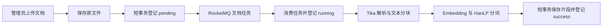
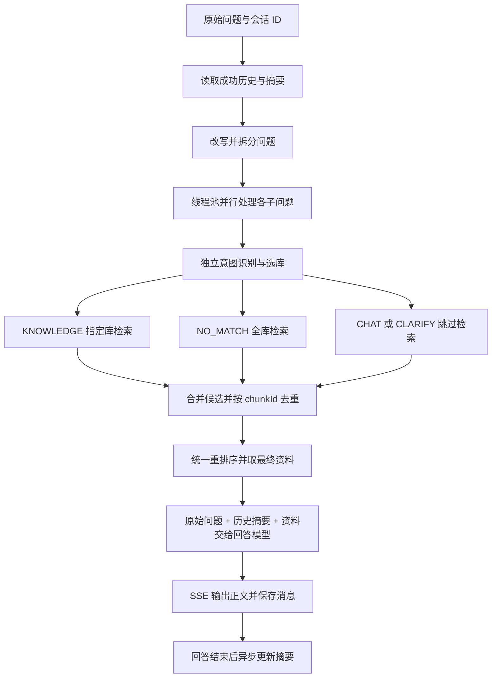

# 慧答 HuiAnswer

基于 Java 的多知识库 RAG 问答项目，覆盖文档异步导入、混合检索、重排序、多轮对话、流式回答和停止生成。用户直接提问，由后端改写与拆分问题、选择知识库，再结合检索资料生成回答。

当前提供 Vue 前端、后端接口和评测脚本，前后端已完成本地联调及服务器试部署。工程分为 `rag` 和 `framework` 两个 Maven 模块，运行时是一个 Spring Boot 应用。

## 服务器试部署

2026-10-17 已完成 Linux 同机后端试部署，复用原短链接服务器的 Redis、RocketMQ 和 Nginx，新增 PostgreSQL + pgvector 与一个慧答 JAR。前端入口为 [慧答工作空间](http://8.149.237.177/huianswer/)，页面由 Nginx 提供，API 和流式问答转发到慧答后端。

登录、流式问答、停止生成以及 Linux 文件上传和异步入库已验证。服务器使用外置配置覆盖本地 D 盘路径，模型密钥与密码放在服务器私有环境文件中。目录、资源限制、更新步骤见 [Linux 部署说明](deploy/server/README.md)。

## 本地前端预览

在 `frontend/` 下执行 `npm install`、`npm run dev`，打开 `http://127.0.0.1:5174/huianswer/`。默认通过 Vite 代理连接服务器后端；开发模式下可在登录页点击“先看看界面”，使用清楚标记的内存示例数据预览，不调用模型或修改服务器数据。

前端已验证真实登录、SSE 回答、历史引用、知识库与片段查询、登录失效跳转，并检查桌面与手机布局。构建命令为 `npm run build`，产物为 `frontend/dist/`。配置及源码入口见 [前端说明](frontend/README.md)。

## 已实现功能

| 功能 | 当前实现 |
| --- | --- |
| 前端工作区 | Vue 3 + Vite；登录、流式聊天、引用、历史会话和管理员知识库管理，支持手机布局 |
| 用户与权限 | 预置账号登录、BCrypt 密码校验、Redis token 登录；知识库管理限定 `admin` 账号，关闭公开注册 |
| 知识库管理 | 创建、查询、修改名称与业务描述、删除；记录创建者 |
| 文档管理 | TXT、Markdown、文本型 PDF 上传，异步处理状态查询、失败重试、启停、删除、文档与片段分页 |
| 文档入库 | 本地保存原文件，RocketMQ 消费后用 Tika 解析、分块、向量化，批量保存片段 |
| 问题理解 | 使用最近两轮成功对话完成指代消解、条件补全与问题拆分，结构化输出失败时降级为原问题 |
| 检索与路由 | 每个子问题独立分类、选库和检索；向量与关键词两路召回，RRF 融合，合并去重后统一重排序 |
| 多轮对话 | 按用户隔离会话，保存问题、回答、引用及结束状态；最近历史与滚动摘要共同参与问答 |
| 流式与停止 | SSE 输出正文，支持用户停止；共享 Redis 标记、订阅通知与定时检查协调跨实例停止 |
| 评测 | 三种检索策略对比、完整问答质量评估、低分题报告和首字响应时间统计 |

## 技术与代码结构

JDK 17、Spring Boot 3.0.7、MyBatis-Plus 3.5.12、PostgreSQL + pgvector、Redis + Redisson、RocketMQ、Tika、HanLP、OkHttp、Gson。评测使用 Python 和 Ragas。

```text
HuiAnswer/
├── framework/           # 统一返回、异常处理、防重复提交、消费幂等、方法计时
├── rag/
│   └── src/main/java/com/lhsg/HuiAnswer/rag/
│       ├── admin/       # 账号登录、请求拦截、用户上下文
│       ├── knowledge/   # 知识库、文档、片段、解析、分块、向量化及 MQ 导入
│       ├── retrieval/   # 改写拆分、意图路由、混合检索、重排序
│       ├── chat/        # 问答编排、SSE、生成任务和停止控制
│       ├── memory/      # 会话、消息、历史窗口与异步摘要
│       ├── assessment/  # 独立检索评测接口
│       └── config/      # 数据库、线程池、模型地址、拦截器等配置
├── sql/                 # 建表与按编号执行的增量脚本
├── frontend/            # Vue 前端，资源与路由前缀 /huianswer/
├── deploy/rocketmq/     # 本地 RocketMQ、Redis 的 Docker Compose
├── evaluation/          # 合成语料、题集、采集、评分与报告脚本
├── tools/               # 已有片段重新向量化工具
└── docs/                # 文档管理接口、向量迁移说明
```

### 文档导入



- 消息只携带 `kbId`、`docId`，消费者按记录读取原文件。上传响应代表任务已登记，需查询文档的 `status` 确认结果。
- 解析、模型请求放在数据库事务外；片段写入与成功状态在同一短事务中提交。失败后另行登记 `failed`，避免失败状态随事务一起回滚。
- 生产者发送失败后指数退避，首次发送加最多 5 次重试，复用同一个消息 key；耗尽后记录文档失败，支持手动重试。
- 消费者使用 Redis 幂等注解，并配置 `maxReconsumeTimes=3`。生产者发送重试与消费者重试分别处理，发送失败不会自动进入消费死信队列。
- 分块默认 500 个 Unicode 码点、重叠 100；向量请求每批最多 32 块，数据库写入每批 100 条。
- 删除知识库或文档会逻辑删除相应业务记录，并物理清理片段；磁盘原文件暂时保留。

### 问答链路



1. 问答请求不接收知识库 ID。路由目录来自知识库名称和 `description`，由模型选择一个或多个有效知识库。
2. 同一轮先提交全部子问题任务，每个任务完成自己的路由和检索，等待全部结果后统一重排序。向量与关键词两路目前在单个子任务内部顺序执行。
3. `KNOWLEDGE` 查询选定知识库；`NO_MATCH` 或路由调用异常降级为全库检索；`CLARIFY` 和 `CHAT` 不检索，最终回复仍由回答模型生成。
4. 子问题和改写文本服务于检索；最终回答模型接收用户原始问题、历史与摘要、最终资料，不把改写文本替换为用户原话。
5. 文档启用且处理成功、知识库及关联记录未删除时，片段才能参与检索。范围参数内部约定为：`null` 查全库，空列表不检索，有 ID 的列表查指定库。

### 检索、记忆与并发控制

| 项目 | 当前参数与做法 |
| --- | --- |
| 向量 | `Qwen/Qwen3-Embedding-0.6B`，1024 维；问题与文档使用同一模型配置 |
| 向量召回 | PostgreSQL `<=>` 余弦距离升序，每个子问题最多 20 块，再保留距离小于 0.6 的结果 |
| 关键词召回 | HanLP 分词，`search_text` 保留词序与重复词；生成列 `search_vector` 配合 GIN 索引，用 `ts_rank_cd` 排序，最多 20 块 |
| 融合 | 按两路名次做 RRF，`k=60`；每个子问题保留最多 10 个候选，不直接相加距离和关键词分数 |
| 重排序 | 各子问题候选合并去重，`BAAI/bge-reranker-v2-m3` 统一重排，最终最多 6 块 |
| 改写历史 | 最近两轮成功问答，最多四条消息，不传摘要 |
| 回答历史 | 最多最近八轮成功问答原文，加已有摘要；失败或停止的回答不组成成功历史轮次 |
| 摘要 | 八轮窗口之外的历史积累满三轮后滚动压缩，更新摘要正文及已覆盖轮次；异步执行，失败时保留旧摘要 |
| 会话并发 | Redisson 会话锁覆盖本轮生成及收尾，同一会话正在生成时拒绝新的提问 |
| 停止 | 本地任务对象 + Redis 任务/停止记录 + RTopic 通知，每 5 秒扫描兜底；工作线程统一入库、收尾和解锁 |

参数见 [application.yml](rag/src/main/resources/application.yml)。当前向量查询为精确检索，尚未建立 HNSW/IVFFlat 近似索引。

## 本地启动

### 1. 准备运行环境

- JDK 17、Maven 3.9，`java`、`mvn` 指向对应安装目录。
- PostgreSQL 16，安装 pgvector 扩展；默认地址 `localhost:5432`，数据库 `huianswer`。
- Redis 默认 `localhost:6379`；RocketMQ NameServer 默认 `127.0.0.1:9876`。
- DeepSeek 官网密钥，以及硅基流动密钥。

项目提供 RocketMQ 和 Redis 的本地配置，在仓库根目录执行：

```powershell
docker compose -f deploy/rocketmq/compose.yml up -d
docker compose -f deploy/rocketmq/compose.yml ps
```

这份 Compose 不包含 PostgreSQL。若本机已有同端口服务，可复用对应服务。Broker 配置面向本机客户端，跨主机部署需调整 `brokerIP1` 和端口。默认数据目录在 `D:/develop/huiAnswer/data` 下，换机器时检查挂载路径。

### 2. 设置环境变量

必填变量如下，实际值不写入仓库：

| 变量 | 用途 |
| --- | --- |
| `HUIANSWER_DB_PASSWORD` | PostgreSQL 密码 |
| `DEEPSEEK_API_KEY` | 官网的回答、改写、意图识别、摘要调用 |
| `HUIANSWER_AI_API_KEY` | 硅基流动的 Embedding、Rerank，以及默认评分脚本 |

已有 Windows 用户环境变量时，在启动应用的 PowerShell 中读取：

```powershell
foreach ($name in @('HUIANSWER_DB_PASSWORD', 'DEEPSEEK_API_KEY', 'HUIANSWER_AI_API_KEY')) {
    $value = [Environment]::GetEnvironmentVariable($name, 'User')
    if ([string]::IsNullOrWhiteSpace($value)) {
        $secret = Read-Host $name -AsSecureString
        $value = [System.Net.NetworkCredential]::new('', $secret).Password
    }
    [Environment]::SetEnvironmentVariable($name, $value, 'Process')
}
```

没有持久化的值会在当前终端隐藏输入，仅供本次启动使用。IDEA 继承其父进程环境，在旧终端或未退出的桌面启动器中重开 IDEA，可能仍继承旧值。

其他连接地址、存储目录和模型变量见 [.env.example](.env.example)。Spring Boot 不会自动加载该文件或 `.env`。本机的 `start-local.ps1`、`start-idea.ps1` 未随仓库分发，新机器按这里的标准命令启动即可。

### 3. 初始化数据库

以下命令需要本机有 PostgreSQL 命令行客户端。首次创建数据库；已有 `huianswer` 时跳过第一条：

```powershell
$env:PGPASSWORD = $env:HUIANSWER_DB_PASSWORD
createdb -h localhost -p 5432 -U postgres huianswer

Get-ChildItem .\sql\*.sql | Sort-Object Name | ForEach-Object {
    psql -h localhost -p 5432 -U postgres -d huianswer -X -v ON_ERROR_STOP=1 -f $_.FullName
    if ($LASTEXITCODE -ne 0) { throw "执行 $($_.Name) 失败" }
}
```

新库按 `01` 至 `10` 顺序执行，包含知识库、文档、片段、账号、创建者、会话、消息、摘要、启停和关键词字段。知识表包含部分数据库外键，会话与消息归属另由业务代码校验。

`02_admin.sql` 预置本地演示管理员；知识库管理要求使用 `admin` 登录。已有库按需执行迁移：`CREATE TABLE IF NOT EXISTS` 不会升级旧向量列，4096 维旧数据需先阅读 [向量迁移说明](docs/embedding-migration.txt)，使用 [重新向量化工具](tools/reembed_chunks.py)，不能直接截断为 1024 维。

### 4. 构建并运行

```powershell
mvn -B -ntp -pl rag -am -DskipTests package
java -jar rag/target/rag-1.0-SNAPSHOT.jar
```

默认接口地址为 `http://localhost:8080`，可用 `HUIANSWER_PORT` 修改。这是 API 服务地址，当前还没有首页界面。

原文件默认保存在 `D:/develop/huiAnswer/data/documents/{kbId}/`，上传临时目录为 `D:/develop/huiAnswer/data/tmp`。可分别用 `HUIANSWER_STORAGE_DIR`、`HUIANSWER_UPLOAD_TEMP_DIR` 覆盖。

### 模型调用配置

回答、改写、意图识别和摘要使用官网 `https://api.deepseek.com/chat/completions`，默认模型名 `deepseek-flash`。向量化和重排序继续使用硅基流动。模型地址与密钥分别绑定，评分模型也可单独配置。

改写、意图识别与摘要显式关闭思考；回答保留按意图选择思考模式的行为。回答预算为 8192 token，包含思考与正文，是单次输出上限；空正文按失败处理，有正文但 `finish_reason=length` 时保留已生成内容。

## 接口与联调

普通接口沿用 `Result`：成功 `code` 为字符串 `"0"`，业务失败需读取 `code` 和 `message`，不能只看 HTTP 200。登录后通过请求头传递：

```http
username: admin
token: <登录响应中的 data.token>
```

| 方法 | 路径 | 用途 |
| --- | --- | --- |
| POST | `/api/hui-answer/login` | 登录，传 `username`、`password`，返回 token |
| POST / GET | `/api/knowledge-base` | 创建知识库 / 知识库列表 |
| GET / PUT / DELETE | `/api/knowledge-base/{id}` | 查询 / 修改 / 删除知识库 |
| POST / GET | `/api/knowledge-base/{kbId}/documents` | 上传文件 / 文档分页 |
| GET / DELETE | `/api/knowledge-base/{kbId}/documents/{docId}` | 查询状态 / 删除文档 |
| POST | `/api/knowledge-base/{kbId}/documents/{docId}/retry` | 重试失败文档 |
| PUT | `/api/knowledge-base/{kbId}/documents/{docId}/enabled` | 启停，正文 `{"enabled":0}` 或 `{"enabled":1}` |
| GET | `/api/knowledge-base/{kbId}/documents/{docId}/chunks` | 片段分页 |
| POST | `/hui-ansWer/chat/stream` | 流式问答，注意路径大小写 |
| POST | `/api/hui-answer/conversation/{conversationId}/stop` | 停止生成，传 `generationId` |
| GET | `/api/hui-answer/conversation` | 当前用户会话列表 |
| PUT / DELETE | `/api/hui-answer/conversation/{conversationId}` | 修改标题 / 删除会话及关联消息、摘要 |
| GET | `/api/hui-answer/{conversationId}` | 查询自己的消息历史，含正文、引用和结束状态 |
| POST | `/api/evaluation/retrieval` | 独立检索评测，策略及调用方式见评测脚本 |

文档和片段分页使用 `current`、`size`，默认 `1`、`10`。`enabled=0` 表示启用，`1` 表示禁用。文档详情与删除规则见 [文档管理接口](docs/document-management.md)。

联调顺序：登录管理员，创建带 `name`、`description` 的知识库，以 `multipart/form-data` 的 `file` 字段上传文档，查询至 `status=success`，再发送问答。描述写明资料的业务范围，供路由选库使用。

### SSE 约定

首次提问省略 `conversationId`，续聊传入 `meta` 返回的会话 ID：

```json
{"question":"质量问题退货的运费由谁承担？","conversationId":null}
```

```text
event: meta
data: {"conversationId":123,"generationId":"本次生成的UUID"}

event: delta
data: 依据当前资料，

event: delta
data: 需要区分退货原因和运费规则。

event: done
data: [DONE]
```

- SSE 的 `delta` 只输出答案正文，不输出模型思考过程。客户端应按事件解析，不能按普通 JSON 响应读取。
- `generationId` 标识本次生成，收到 `meta` 即可提交停止请求；停止时尽可能发送 `stopped`，其他失败发送 `error`。
- 回答中的 `[1]` 等编号对应本次资料。来源列表保存在消息的 `sources` 字段，可从历史接口读取；正常 SSE 当前没有单独的来源列表事件，前端对接时需补齐这个输出。
- `rag.evaluation.enabled=true` 时额外发送 `evaluation`，内容为本次真正送入回答模型的片段，空资料也发送 `[]`。日常使用可关闭此开关。

## 评测与结果

### 数据与口径

使用合成的星澜商城语料，包含商品、订单、配送、售后四个知识库。v2 在原 16 份资料上增加 12 份有适用范围差异的干扰文档，共 28 份；语料、题目和参考答案分别保存。

- 独立检索对照：16 道有答案的开发题，每题比较 `vector`、`mixSearch`、`rerank`，统一取前 6 个片段，使用预设的正确知识库范围。
- 完整问答：20 道开发题直接调用真实问答接口，不预先传正确知识库；其中 16 道评分，4 道澄清、闲聊或无答案题人工检查。多轮题的前置回答也由真实接口生成。
- 评分证据来自本次 SSE `evaluation` 的实际片段和 `delta` 的实际回答，不回查数据库替换证据；参考答案仅供评分，不进入业务模型请求。

### 2026-10-16 官网适配测试快照

| 指标 | 均分 | 用途 |
| --- | ---: | --- |
| Context Recall | 0.9479 | 参考答案的事实是否能从最终资料中找到支持 |
| Context Precision | 0.9655 | 有用资料是否排在靠前位置 |
| Faithfulness | 0.9190 | 回答的事实是否有实际上下文支持 |
| Answer Point Coverage | 0.9479 | 自定义必要要点覆盖率，补充检查答案是否漏答 |
| Factual Correctness | 0.5138 | 与参考答案对照的辅助 F1，结合有效扩写与逐题判定阅读 |

同批 20 道主问题的首个正文响应时间：平均 5.347 秒、中位数 3.716 秒、P95 12.094 秒。计时从问答 HTTP 请求发出至收到首个非空正文，包含准备阶段与模型等待，不用 `meta` 或思考内容冒充首字。

采集批次 `20261016-223825-250641`，评分批次 `20261016-225243-922140`，评分口径 `generation-v3`、参考答案版本 `generation-dev-v2`。该快照来自官网适配测试分支；本地 `runs` 产物默认不提交。模型、语料、参考答案和评分口径变化时，应分开记录，开发集分数不等同于真实用户正确率。

### 脚本入口

| 脚本 | 用途 |
| --- | --- |
| [collect_retrieval.py](evaluation/collect_retrieval.py) | 采集三种检索策略的片段与耗时 |
| [score_retrieval.py](evaluation/score_retrieval.py) | 用 Ragas 评估召回与排序 |
| [collect_generation.py](evaluation/collect_generation.py) | 采集真实 SSE 问答、资料、首字时间及过程事件 |
| [score_generation.py](evaluation/score_generation.py) | 对已采集问答计算五项指标 |
| [report_low_scores.py](evaluation/report_low_scores.py) | 将主要指标低于各自平均值的题整理成易读报告 |
| [generation_pipeline_report.py](evaluation/generation_pipeline_report.py) | 汇总过程事件和首字响应时间 |

采集使用 Python 3.10+；评分依赖见 [requirements-eval.txt](evaluation/requirements-eval.txt)，建议独立虚拟环境，本机放在 `D:/develop/huiAnswer/eval-venv`。采集需应用已启动、资料处理成功、登录 token 有效；评分只读采集结果，但会产生评委模型调用费用。

```powershell
python evaluation/collect_retrieval.py --dataset evaluation/xinglan-shop-v2 --dry-run
python evaluation/collect_retrieval.py --dataset evaluation/xinglan-shop-v2
python evaluation/score_retrieval.py --results "<本次检索采集目录>/results.jsonl"

python evaluation/score_generation.py --results "<本次问答采集目录>/results.jsonl"
python evaluation/report_low_scores.py --scores "<本次评分目录>/scores.jsonl"
```

完整过程采集目前配合 `feature/evaluation` 分支后端使用：主分支发送 `evaluation`，不发送 `evaluation_trace`、`evaluation_stats`；生成采集脚本默认要求三类事件，不能直接把两种模式混用。请用 `--results`、`--scores` 固定要分析的批次，避免默认选到其他语料或旧运行。

## 当前限制与后续对接

- 引用在生成结束后读取消息历史展示，正常 SSE 暂无独立来源事件。
- 管理员身份当前按账号名识别，未实现完整角色权限系统。
- 模型选库仍可能遗漏跨库子问题；统一 Top 6 重排序可能挤掉某个子问题的关键资料，这两项需结合逐题证据继续改进。
- 首字响应仍有长尾，受改写、路由、外部模型响应共同影响，当前数据未覆盖大规模并发。
- 停止可主动取消最终问答模型的 Call；改写、检索和重排序在阶段返回后检查停止标记。
- 原文件使用本地磁盘，无 OCR；跨实例文档消费需要共享可读的文件存储。Redis 消费幂等有有效期，不代表永久去重或消息只处理一次。
- 提示词与结构化结果校验已做输入边界约束，仍需持续验证模型行为，不承诺完全杜绝提示词注入。

建议从 `ChatServiceImpl` 阅读完整问答编排，再看 `RewriteQuestion`、`SubQuestionProcessor`、`SearchChunks`、`RerankChunks`；文档链路从 `KnowledgeDocumentServiceImpl`、`DocumentProducer`、`DocumentConsumer` 阅读；记忆与停止分别看 `SummaryServiceImpl`、`ChatGenerationManager`。
